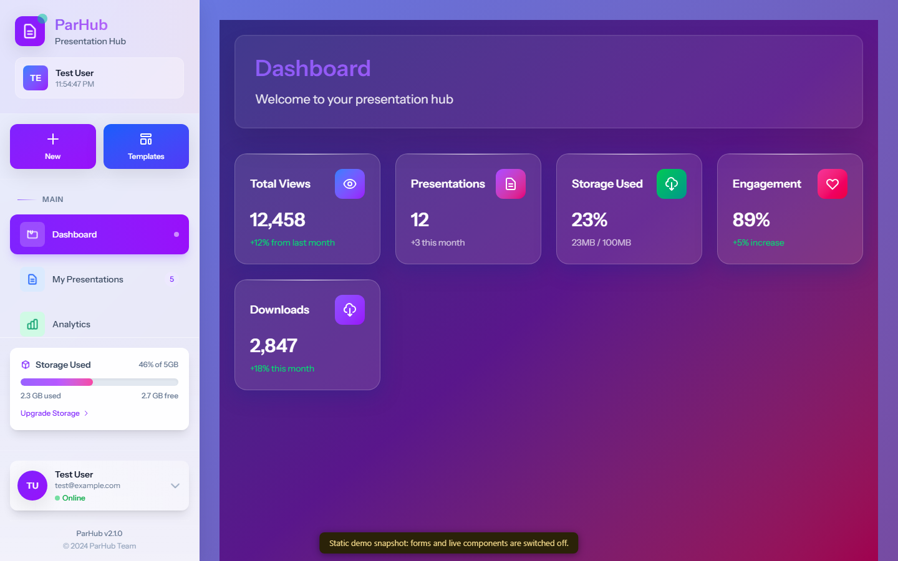

<div align="center">

# ParHub

**A presentation management platform: create, organize, search and track presentations from one workspace.**

[](https://faisalalghates.github.io/par/)


**[Live demo](https://faisalalghates.github.io/par/)** · [Features](#features) · [Run it](#run-it) · [Structure](#project-structure) · [Roadmap](#roadmap)



</div>

> **About the demo.** The live demo is a read-only static snapshot of the running app (a CI job boots Laravel with the seeded data, signs in and saves the pages). Forms, uploads and live components do not work in it. Run the project locally for the real thing.

## What it does

ParHub gives each user one workspace for the whole life of a presentation: start from a template or an uploaded file, organize it, search for it later, and see how it is used.

## Features

| Area | What you get |
| --- | --- |
| **Workspace** | Interactive dashboard, advanced dashboard and analytics views, quick statistics |
| **Presentations** | Create, edit, view and delete; draft, published and archived states; view tracking |
| **Uploads** | PDF, DOCX and PPTX files linked to a presentation and its owner |
| **Templates and categories** | Template library with preview and download, category management |
| **Search** | Full search with suggestions and autocomplete |
| **AI-assisted creation** | A workflow that takes structured input (title, type, theme, slide count) and creates a presentation record with a slide structure and AI metadata, for business, educational, marketing and portfolio decks |
| **Account** | Registration, login, email verification, password recovery, profile and appearance settings |
| **Housekeeping** | Media library, shared files, trash, billing and upgrade screens |

> The AI workflow builds the presentation structure from the input you provide. Calling an external AI model and exporting to PowerPoint are on the [roadmap](#roadmap), not part of the current version.

## Tech stack

- **Backend:** PHP 8.2+, Laravel 12, Livewire with Volt and Flux, Laravel Modules
- **Frontend:** Blade, Alpine.js, Tailwind CSS 4, Vite
- **Data:** any Laravel-supported database (SQLite by default)
- **Quality:** Pest, Laravel Pint

## Run the whole app (Docker)

The static demo above is a snapshot. The real app, with working forms, uploads and sign-in, runs from the included `Dockerfile`: PHP, the built front end and a SQLite database seeded on start.

```bash
docker build -t parhub-demo .
docker run --rm -p 8080:10000 parhub-demo
```

Open <http://localhost:8080>. Sign in with `test@example.com` / `password` (created by the seeder), or open `/test-login`. A GitHub Action builds this image on every push and requests every page of the app: dashboard, advanced dashboard, analytics, presentations, templates, categories, search, media, shared, trash, AI assistant, import and export, help, billing, upgrade and the settings.

[](https://render.com/deploy?repo=https://github.com/FaisalAlghates/par)

> The Render button deploys the same image on Render's free plan: the first request after a pause is slow, and the data is reset each time the instance restarts. Use it for demos only, never with real data.

## Run it

You need PHP 8.2+, Composer and Node.js.

```bash
git clone https://github.com/FaisalAlghates/par.git
cd par/ParHub

composer install
npm install

cp .env.example .env
php artisan key:generate
touch database/database.sqlite   # or configure another database in .env

php artisan migrate --seed       # also creates a test user: test@example.com / password
```

Then, in two terminals:

```bash
php artisan serve
npm run dev
```

Open <http://127.0.0.1:8000>. Run the tests with `php artisan test`.

## Project structure

```text
ParHub/
├── app/                 Controllers, Livewire components, models
├── Modules/             Admin, Documentation, LandingPage, Presentation
├── database/            migrations, factories, seeders
├── resources/views/     ai-assistant, analytics, presentations, templates, media, shared, dashboard
├── routes/              web.php, auth.php
└── composer.json · package.json
```

## Security notes

`routes/web.php` contains development helpers (`/test-login`, `/quick-login`, `/debug-auth`, `/db-stats`) that sign a user in or show system information without credentials. **Remove them, or guard them behind `app()->isLocal()`, before deploying this app anywhere public.**

## Roadmap

- Call a real AI model to write slide content, speaker notes and images
- Generate and export PowerPoint files
- Real-time collaborative editing
- Advanced analytics, cloud storage, subscriptions and payments
- More presentation formats and Arabic content generation

## License

Available for educational and portfolio purposes.
